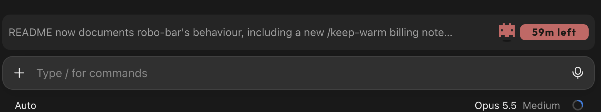

# robo-bar

A Claude Code mod that adds a bar above the prompt. On the left, a one-line summary of Claude's last answer. On the right, a pixel robot and a chip that show whether the prompt cache is still hot, and how long it has left.



## The bar

- **Summary (left):** a dim one-line summary of the last answer.
  - Answers that already fit on one line (up to 95 characters) are shown as they are, with no model call.
  - Longer answers are summarized by Haiku at low effort, which costs a fraction of a cent. The summary appears a moment after the answer.
  - The summary is cut at a word break with "…", so it never pushes the badge off the bar. On desktop it can use up to 95 characters; in the terminal, one character per column.
- **Badge (right):**
  - **Hot:** the robot bobs and a red chip counts down, e.g. "58m left". Claude Code's prompt cache lives 1 hour after the last request that read or wrote it.
  - **Cold:** the robot is frozen in ice and a blue chip reads "COLD".
  - In the terminal, the chip is plain colored text with no robot.
- **When it's hidden:** while Claude is working, before the session's first finished turn, and while the app shows its own question box.

## `/keep-warm`

Keeps the session's prompt cache warm while you're away. It's off by default and set per session.

- `/keep-warm` toggles it; `/keep-warm on` and `/keep-warm off` set it.
- When it's on and the session is idle, a hidden ping goes out 2 minutes before the cache expires. The ping re-reads the cached chat, which restarts the cache's 1-hour clock, and its reply is thrown away.
- At most 3 pings in a row; the count starts over when you send a message.
- A toast confirms each ping. If a ping misses the cache, the pings pause until your next message.

Each ping is a full request over the cached chat, billed at the cache-read rate.

## `/robo-bar-ruler`

Toggles a measuring ruler in the bar, for this session. The bar shows what the surface reports (`bodyColumns`, viewport width, and the room robo-bar computes for the summary), then rows of text 40 to 120 characters long, each beside the badge and ending in `|`. The longest row whose `|` still shows is how much text fits on that surface.

## State

Each session's last cache time and keep-warm setting are saved, so they survive restarts and resumes. Entries for sessions idle more than a day are cleared.

## Install

At the prompt of a Claude Code terminal session:

```
/plugin install robo-bar --marketplace Maik93/claude-code-robo-bar
```

From a shell:

```bash
claude plugin install robo-bar --marketplace Maik93/claude-code-robo-bar
```

In the desktop app, where `/plugin` does not run: click + next to the prompt box, then Plugins, Add marketplace with `Maik93/claude-code-robo-bar`, then Add plugin.

## Update

```bash
claude plugin marketplace update robo-bar
```

```bash
claude plugin update robo-bar@robo-bar
```

Then run `/reload-plugins` in open sessions, or start a new one.

## Credits

The robot icon and the chip are adapted from [ribbon](https://github.com/robonuggets/ribbon) by Jay E | RoboNuggets, under the MIT License ([third_party/ribbon-LICENSE](third_party/ribbon-LICENSE)).

The embedded font, taken from ribbon, is [Outfit](https://github.com/Outfitio/Outfit-Fonts), under the SIL Open Font License 1.1.

## License

MIT, see [LICENSE](LICENSE).
